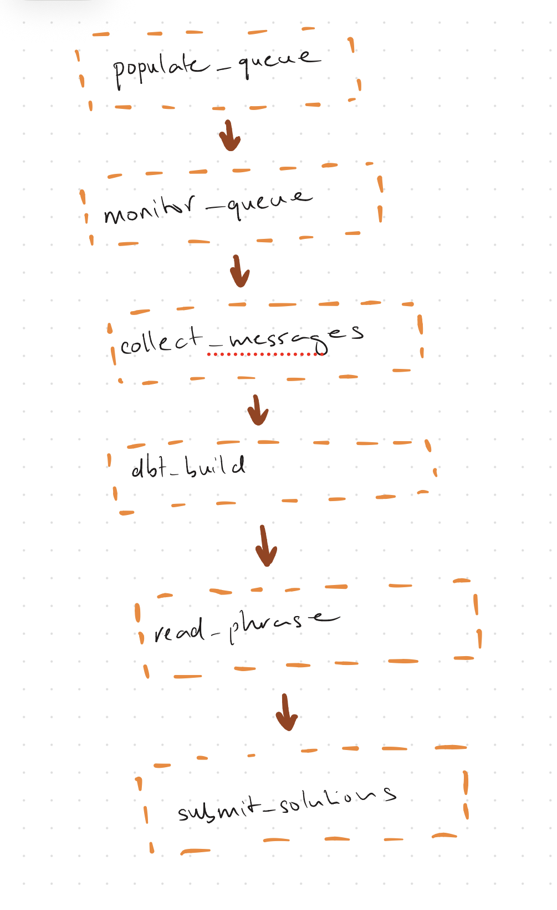
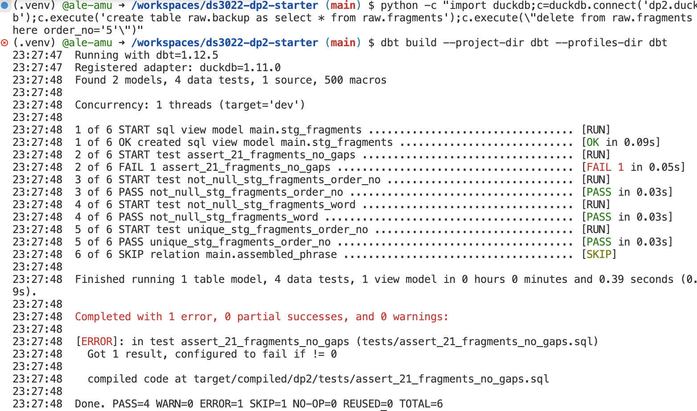
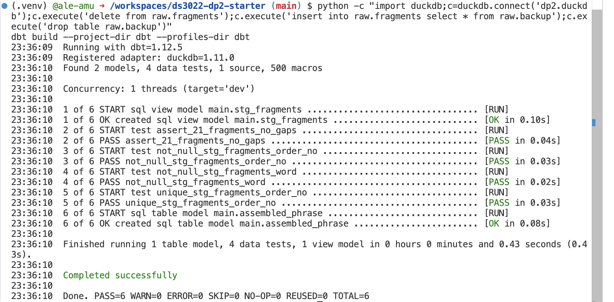
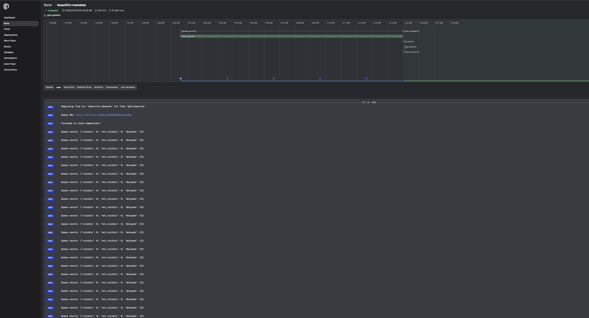
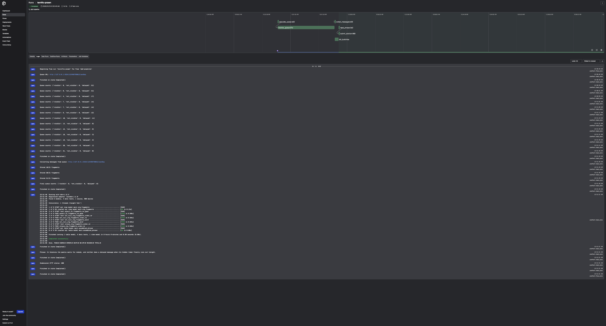

# DS 3022 Data Project 2 (Fall 2026): The SQS Puzzle

This data project is a puzzle. Your goal is to put the pieces back together in the right order.

You will write a **Prefect** data pipeline that retrieves 21 messages from an SQS queue, parses their contents, and reassembles a complete phrase from the fragments, one word per message. Your pipeline can run a single time to produce a complete result, or it can run on a schedule. Design your workflow however you see fit. You can run it as many times as you like while testing.

> Adapted from Neal Magee's Fall 2025 Data Project 2 (UVA). The puzzle is the same. Two things are new this year:
> 1. **The queue runs on your laptop.** A free SQS emulator replaces AWS, so you need no AWS account or credentials. Your code is still ordinary `boto3`: one environment variable (`AWS_ENDPOINT_URL_SQS`) decides whether it talks to your laptop or to real AWS.
> 2. **dbt is the quality gate.** Fragments are landed in DuckDB, and a dbt model reassembles the phrase. dbt tests must pass before your flow is allowed to submit.

**Due:** Monday 19 October 2026, **23:59** (Lesson 11 that afternoon is a working session: evidence run, chaos round and independent build time with instructor help). **Weight:** 20%.

Before anything else, follow **[SETUP.md](SETUP.md)** until `python kit/smoke_test.py` prints `Emulator OK`. SETUP.md also explains the four terminals you keep open while you work.
Work through **[CHECKPOINTS.md](CHECKPOINTS.md)**, check your work against **[RUBRIC.md](RUBRIC.md)**, and keep **[PROGRESS.md](PROGRESS.md)** up to date.

## Architecture

```
POST /api/scatter/<UVA_ID>          (kit/scatter_api.py, your laptop)
        |
        v
SQS queue <UVA_ID>  -- 21 messages, each delayed 30-900 s --
        |
        v
Prefect flow  (prefect-flow.py)
   monitor counters -> receive -> land in DuckDB raw.fragments -> delete
        |
        v
dbt build  (dbt/)
   stg_fragments (typed, de-duplicated) -> tests -> assembled_phrase
        |
        v
send_message to queue dp2-submit  ->  python kit/check_submission.py  ->  receipt code
```

## Task 1: Populate your SQS queue

Make an HTTP `POST` request to the scatter API with your UVA computing ID (the scatter API must be running, see SETUP.md):

```
http://127.0.0.1:8000/api/scatter/<UVA_ID>
```

```python
import requests

url = "http://127.0.0.1:8000/api/scatter/mst3k"
payload = requests.post(url).json()
```

```python
import httpx

url = "http://127.0.0.1:8000/api/scatter/mst3k"
payload = httpx.post(url).json()
```

The response gives you your queue URL:

```
>>> payload
{'hello': 'mst3k', 'sqs_url': 'http://127.0.0.1:9324/123456789012/mst3k', 'messages': 21, 'mode': 'fast (5-60s delays)'}
```

Your request sends exactly **21** messages to your queue, each with a random `DelaySeconds` between **30 and 900 seconds** (5 to 60 seconds while `DP2_FAST=1`, for development). **Keep these delays in mind as your pipeline proceeds to the next task.**

**NOTE:** Do not repeat this POST if your pipeline runs more than once (for example on a schedule) or inside a retry loop. Each POST empties your queue and sends all 21 messages again.

## Task 2: Monitor your queue, then collect, land and delete

Track how many messages are waiting with `get_queue_attributes()`. Three values count messages, and together they make up the total:

- `ApproximateNumberOfMessages` (visible, ready to receive)
- `ApproximateNumberOfMessagesNotVisible` (received by someone, not yet deleted)
- `ApproximateNumberOfMessagesDelayed` (still hidden by their delay)

Decide on a strategy for how and when to pick up messages, explain it in your README, and code it.

Each message has a `Body` containing the same meaningless word. The meaningful content is in `MessageAttributes`. Ask for it explicitly with `MessageAttributeNames=["All"]`, then read each attribute's `StringValue`:

```python
msg = resp["Messages"][0]
order_no = msg["MessageAttributes"]["order_no"]["StringValue"]   # a string, not an int
word     = msg["MessageAttributes"]["word"]["StringValue"]
```

Requirements:

- **Land every fragment in DuckDB** (default file `dp2.duckdb`, table `raw.fragments` with at least `order_no`, `word`, `received_at`) **before** you delete its message.
- Delete each message with its `ReceiptHandle` after storing it. Your pipeline must receive, store and delete **all** messages. Leave no "dangling" messages behind.
- Handle empty or delayed responses gracefully. When nothing is visible, `receive_message` returns a response **without** a `Messages` key; your pipeline must not crash on it.
- Use a timeout so the pipeline fails clearly, rather than hanging forever, if fragments never arrive.

## Task 3: Reassemble with dbt, then submit

Build the phrase with dbt inside `dbt/` (the project, profile and source are already set up):

- `models/staging/stg_fragments.sql`: cast `order_no` to an integer and clean `word`. Make this robust to a fragment being stored twice.
- `models/staging/schema.yml`: generic tests (`not_null`, `unique`, ...) on its columns.
- `tests/`: at least one singular test that fails unless there are exactly 21 fragments with no gaps in the order numbers.
- `models/marts/assembled_phrase.sql`: one row containing the phrase in order.

Your flow runs `dbt build --project-dir dbt --profiles-dir dbt` (or `dbtRunner` from `dbt.cli.main`) and **must not submit if dbt fails**.

Example of ordering:

```
order_no   word
--------   -----
3          brown
2          quick
4          fox.
1          The
```

gives "The quick brown fox."

Submit your phrase as a message to the separate queue **`dp2-submit`**, with your computing ID and the platform used (`"prefect"`) as message attributes:

```python
def send_solution(uvaid, phrase, platform):
    url = sqs.get_queue_url(QueueName="dp2-submit")["QueueUrl"]
    response = sqs.send_message(
        QueueUrl=url,
        MessageBody="dp2 solution",
        MessageAttributes={
            "uvaid":    {"DataType": "String", "StringValue": uvaid},
            "phrase":   {"DataType": "String", "StringValue": phrase},
            "platform": {"DataType": "String", "StringValue": platform},
        },
    )
    ...
```

Check and log that the response has HTTP status `200`. Then run:

```
python kit/check_submission.py
```

and paste the **receipt code** it prints into your README.

You may observe and rerun your pipeline as often as you like, but in the end your code must fetch, store, test, reassemble and submit without human intervention. You may not receive messages or sort fragments by hand.

## Notes and submission

1. Fork the assignment repository and push your work to your fork.
2. Your Prefect flow lives in `prefect-flow.py`. Secondary flows (subflows) are allowed.
3. Use Prefect's built-in logging. Do not commit log files.
4. Do not commit data, `.duckdb` files, `dbt/target/` or `.env` (the provided `.gitignore` handles this).
5. Do not edit the files in `kit/`: they are the same for everyone and are used to check your submission.
6. Your **README must include**: how to set up and run your pipeline; your polling strategy and why; how your dbt tests protect the result (with a screenshot of a test failing on purpose and then passing); a Prefect dashboard screenshot of one **full-delay run** (`DP2_FAST=0`); your receipt code; and a "Chaos round" section (Lesson 11).
7. Submit the repository link and your self-assessed **[RUBRIC.md](RUBRIC.md)**. Your README is where you explain and defend your design (25% of the grade).

## Reference

- [Working with SQS: practical examples (Neal Magee)](https://github.com/nmagee/learn-sqs)
- [boto3 SQS client documentation](https://boto3.amazonaws.com/v1/documentation/api/latest/reference/services/sqs.html)
- [Prefect documentation](https://docs.prefect.io/v3/get-started)
- [dbt-duckdb adapter](https://github.com/duckdb/dbt-duckdb) and [dbt data tests](https://docs.getdbt.com/docs/build/data-tests)
- [Moto server mode](https://docs.getmoto.org/en/latest/docs/server_mode.html), [ElasticMQ](https://github.com/softwaremill/elasticmq)

---

# My Solution

## Rubric 4.1: Setup and run instructions that work from a fresh clone (emulator, scatter API, `.env`, run command)

1. **Setting up Python environment** (Python 3.12 or 3.13):

***set up a virtual environment***
   ```bash
   python3 -m venv .venv
   source .venv/bin/activate
   pip install -r requirements.txt
   cp .env.example .env
   ```

1b.  set `UVA_ID` to my computing ID.

2. **Start the 3 servers**, each in its own terminal with a venv:
   ```bash
   moto_server -p 9324            # T1: emulator
   python kit/scatter_api.py      # T2: scatter API
   prefect config set PREFECT_API_URL="http://127.0.0.1:4200/api"
   prefect server start           # T4: prefect dashboard (port: http://127.0.0.1:4200)
   ```
3. **emulator: `python kit/smoke_test.py`** should print `Emulator OK`.

4. **Run  pipeline** (in T3: work terminal after setting up venv):
   ```bash
   python prefect-flow.py
   python kit/check_submission.py
   ```

- one command runs the whole pipeline, `check_submission.py`, then prints `PASS` and a receipt code

- **fast mode:** set `DP2_FAST=1` (because its messages are delayed 5-60 s, and a run takes about 1 minute).
- **full-delay mode:** set `DP2_FAST=0` (its messages are delayed 30-900 s, and a run takes up to 15 minutes).
- **chaos mode:** set `DP2_CHAOS=1` (adds 2 duplicate messages and 1 malformed message).

after changing either setting, restart scatter API in T2, then `python kit/scatter_api.py`

## Rubric 4.2: Architecture / DAG diagram with task boundaries and dependencies



The DAG diagram depicts a flow that runs 6 tasks in order: `populate_queue -> monitor_queue -> collect_messages -> dbt_build -> read_phrase -> submit_solution`

## Rubric 4.3: Polling strategy justified: what you chose, why, and what you rejected

I chose to have `monitor_queue` check queue counts every 5 seconds (`poll_s=5`). Each check then calls `get_counts`, which is a function that asks how many messages are in the queue (also asks how many are not visible, and how many are delayed (`get_queue_attributes`)), and logs all three counters. The flows keep going until delayed hits 0, which means every message has come out of hiding. If this takes longer than 1200 seconds (`timeout_s`), a TimeoutError is raised so the run fails instead of hanging.

I chose this because:
- The delays are random (can take up to 900 seconds in full mode), so its difficult to just wait a fixed time.
- So by checking the counters, we know exactly how many messages are still hidden.
- 5 seconds is often enough to see progress in the logs without the emulator getting spammed.
- Also, 1200 seconds is longer than the 900 s maximum delay, so a normal run won't time out, however a broken run also won't hang forever.

I rejected two other options:
- I decided not to just wait a fixed 15 minutes before collecting, because in fast mode I'd then have to wait 15 minutes for messages that would be ready in about 60 seconds. 
- I also rejected polling every second because I found it would flood the logs without much to gain from it, and polling every 60 seconds because it could add up to a minute of delay at the end.

## Rubric 4.4: Receive → persist → delete order and idempotency explained (what happens if the flow crashes between steps)

For each message, my pipeline does these 3 steps :

1. **Receive** first it receives the message from the queue, asks for the associated order number and the word. If nothing is ready yet, it just keeps asking again instead of instantly crashing.
2. **Persist**: the second step is persist, which saves the order number and word in DuckDB.
3. **Delete** lastly, the message is deleted from the queue.

This order matters because a message will only be deleted after its word is safely saved this makes sure that if a message is repeated because the pipeline crashes after saving but the word hasn't been deleted yet, the repeat is harmless because dbt will remove duplicates. If I deleted first and the pipeline crashed before saving, that word would be lost for good and the phrase could never be finished. 

If the pipeline is run again, every run gets the same 21 words, and dbt removes repeats, so running it again always gives the same phrase. 

The pipeline keeps going until all 21 words are saved and the queue is empty. However, if this isn't done after about 300 seconds, it stops with an error however it does tell you how many words it got before the crash.

## Rubric 3.5 and 3.6: Gate wired into the flow: a failed `dbt build` stops the flow before submission; Proved the tests can fail: evidence of a test failing on purpose and then passing

dbt is the check that runs before we submit anything. during its check, it first cleans the fragments by turning order numbers into real numbers so they sort correctly, it also trims extra spaces/gaps from the words, and removes any duplicate fragment that was stored twice.

dbt tests that:

- every fragment has an order number and a word
- no order number appears twice
- there are exactly 21 fragments with no gaps

All tests must pass before dbt builds the final phrase. If a test fails, the flow stops and nothing will be submitted, so it is important to make sure that a wrong or incomplete phrase is never sent.

To prove the specified tests work, I deleted fragment 5 from the database which led to the "21 fragments, no gaps" test failing, because of this failure, the phrase was not built:



However, after putting the fragment back, all the tests passed again:



## Rubric 4.6: Tool roles: what Prefect, dbt and DuckDB each do in this pipeline, and what you would lose by dropping one

| Tool | What it does in my pipeline | What I would lose without it |
|---|---|---|
| **Prefect** | Runs the six steps (as seen in DAG diagram) in order, shows every step and its logs in the dashboard, and marks the run as failed if any step breaks. | I couldn't easily see what ran, where it failed or why, and there would be no history of past runs. |
| **DuckDB** | Saves each fragment as soon as it is received, before its message is deleted. dbt reads from the same database. | The fragments would only exist in memory, so a crash after deleting messages would lose them, and dbt would have nothing to work with. |
| **dbt** | Cleans the fragments, tests that all 21 are there with no gaps or repeats, and builds the phrase. | The phrase would be put together with no checks, so a missing or repeated word could be submitted without anyone noticing. |

## Rubric 4.5: "Chaos round" section: what broke, why, and how you fixed it

Chaos mode adds 2 repeated messages and 1 broken message (no word, and "?" as its order number).

During the first chaos run, the broken message caused a crash, because my code was written to expect every message to have a word. As a result, 14 messages were left in the queue.

This happened because my code failed to expect that a queue can repeat messages and contain bad ones, hence it was written with the assumption that every message would be correct and arrive in the queue only once.

To fix this, i logged broken messages and deleted these after. The code now ensures that repeats are only counted once, and makes sure that dbt removes them. Lastly, the pipeline collects all messages until the queue is empty, to make sure nothing is left out.

After the fix, I was able to run 2 chaos runs consecutively that passed, and the queue was empty at the end:

```
WARNING | Malformed message, deleting it: {'order_no': {'StringValue': '?', 'DataType': 'String'}}
INFO    | Final queue counts: {'visible': 0, 'not_visible': 0, 'delayed': 0}
PASS  aez6aq / prefect  receipt: FBE5E338AB      (chaos run 1)
PASS  aez6aq / prefect  receipt: FBE5E338AB      (chaos run 2)
```


## Rubric 2.4: Full-delay evidence run (`DP2_FAST=0`, 30-900 s) completed end to end

I ran the pipeline once with the real delays (30 to 900 seconds per message). It finished on its own in 14 minutes 27 seconds: it waited until all 21 messages were visible, collected and saved them, passed all the dbt tests and submitted the phrase successfully.



```
Stored 21/21 fragments
Final queue counts: {'visible': 0, 'not_visible': 0, 'delayed': 0}
Done. PASS=6 WARN=0 ERROR=0 SKIP=0 NO-OP=0 REUSED=0 TOTAL=6
Submission HTTP status: 200
Flow run 'beautiful-manatee' - Finished in state Completed()
PASS  aez6aq / prefect  receipt: FBE5E338AB
```

## Rubric 4.7: Results shown: dashboard screenshot, dbt output, receipt code

A completed run in fast mode, shown in the Prefect dashboard:



## Rubric 1.7: Correct answer: `check_submission.py` PASS; receipt code in the README is valid

```
PASS  aez6aq / prefect  receipt: FBE5E338AB
```
